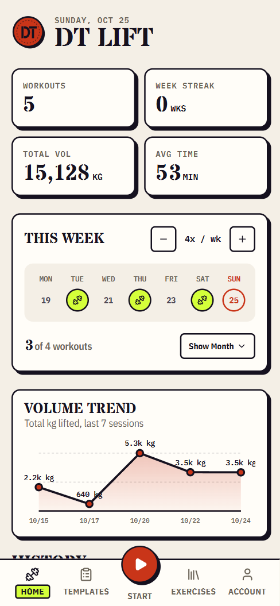
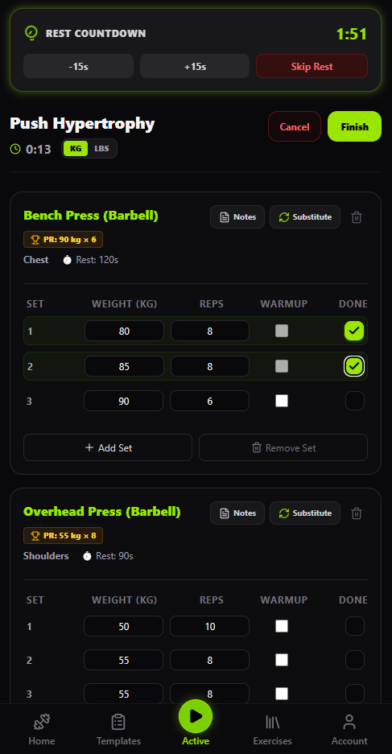
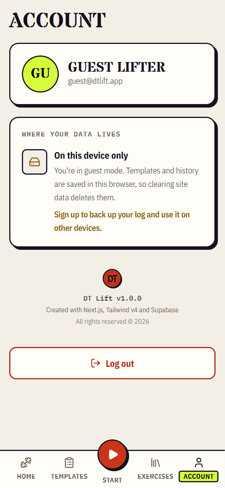

# DT Lift — Gym Workout Tracker

DT Lift is a mobile-first, gym workout tracker designed as a Progressive Web Application (PWA). It empowers users to track their workouts, manage custom templates, browse and manage an exercise library, and log weights and reps with ease. It features full Supabase integration for cloud sync, alongside a fully-functional local fallback/offline guest mode.

View project [here](https://dt-lift.vercel.app/)

---

## 📸 Screenshots

_Below are screenshots of DT Lift in action on mobile devices._

|                      Dashboard                      |                Active Workout                 |                     Account                     |
| :-------------------------------------------------: | :-------------------------------------------: | :---------------------------------------------: |
|  |  |  |

---

## 🚀 Key Features

- **Personalized Dashboard:** View recent workout stats, quick access to start empty workouts, and a summary of your training history.
- **Dynamic Workout Tracker:** Log sets, reps, and weights in real-time. Features timer utilities, set completion toggles, and live duration tracking.
- **Custom Workout Templates:** Create, edit, and delete custom workout routines to quickly start your favorite workouts.
- **Exercise Library:** Categorized exercise list by target muscle groups with search functionality, detail tracking, and custom exercise creation.
- **Supabase Cloud Sync:** Robust integration with Supabase for user authentication and database storage.
- **Local-First Guest Mode:** Don't want to sign up? DT Lift emulates the entire database context using `localStorage` so you can track workouts offline without an account.
- **PWA Ready:** Installable on iOS and Android devices, providing a native app experience with a translucent status bar and offline capability.

---

## 🛠️ Tech Stack

- **Core Framework:** [Next.js](https://nextjs.org/) (v16) with App Router
- **Styling:** [Tailwind CSS](https://tailwindcss.com/) (v4) for clean, utility-first dark mode styling
- **Database & Auth:** [Supabase](https://supabase.com/) via `@supabase/supabase-js` and `@supabase/ssr`
- **Icons:** [Lucide React](https://lucide.dev/) for modern icon assets
- **Storage:** Local Storage fallback for guest mode and configuration
- **Fonts:** Geist and Geist Mono

---

## 📦 Getting Started

### Prerequisites

- Node.js (v18+ recommended)
- npm / yarn / pnpm

### Installation

1. **Clone the repository:**

    ```bash
    git clone https://github.com/denzeltl/dt-lift.git
    cd dt-lift
    ```

2. **Install dependencies:**

    ```bash
    npm install
    ```

3. **Set up environment variables:**
   Create a `.env.local` file in the root directory and add your Supabase credentials:

    ```env
    NEXT_PUBLIC_SUPABASE_URL=your_supabase_project_url
    NEXT_PUBLIC_SUPABASE_ANON_KEY=your_supabase_anon_key
    ```

4. **Run the development server:**
    ```bash
    npm run dev
    ```
    Open [http://localhost:3000](http://localhost:3000) in your browser to see the application.

---

## 📝 TODO Section

- [ ] **Rest Timer Audio Notifications:** Play a chime when the rest timer finishes, even if the app is in the background.
- [ ] **Advanced Analytics:** Strength score on the dashboard.
- [ ] **Per Exercise History & Progression:** Charts for each exercises showing the weight progression.
- [ ] **Exercise Variations:** Allow other forms of exercises like bodyweight and time based exercises.
