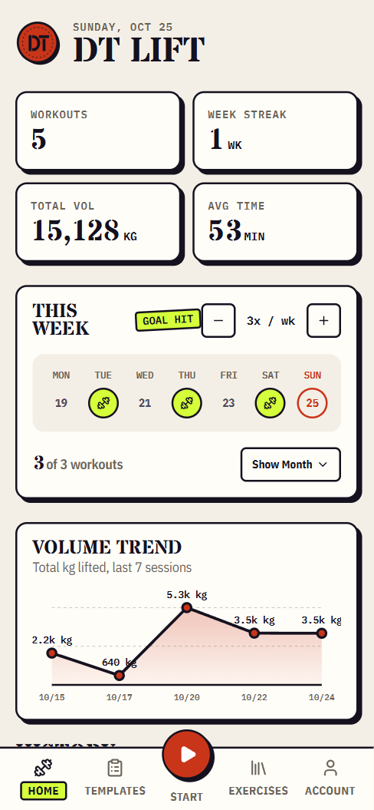
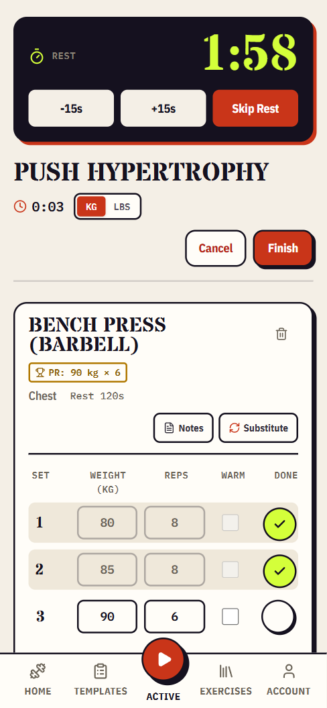
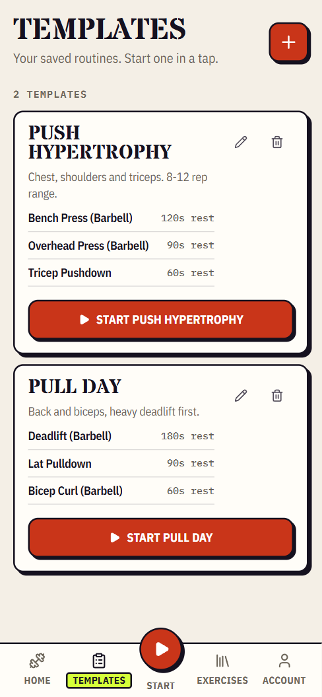
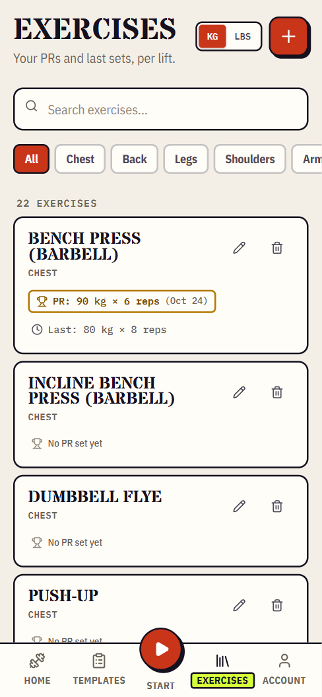
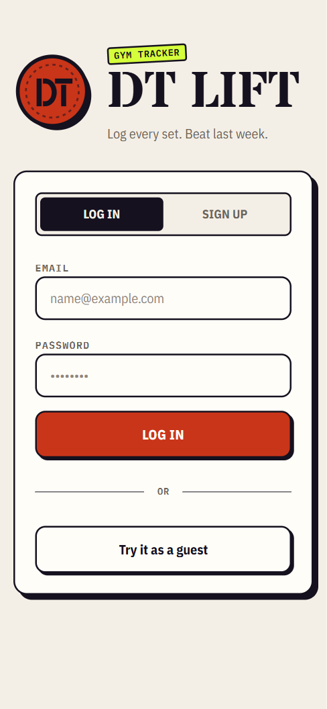
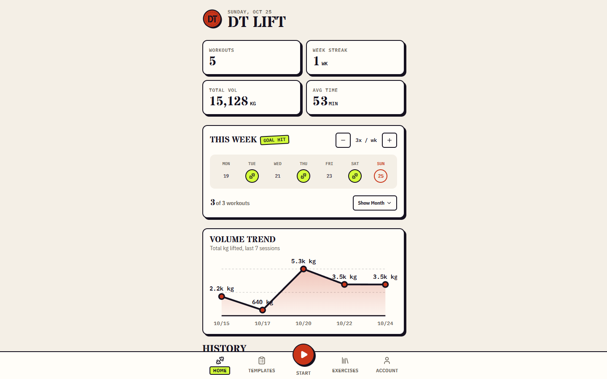
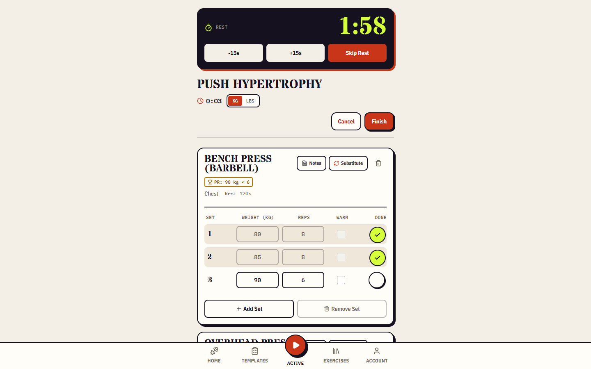
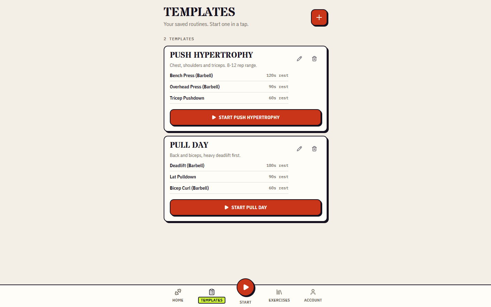

<p align="center">
  
</p>

# DT Lift

A simple gym tracker for your phone. Log your sets, save your favourite routines, and see how much you're lifting over time.

**Try it:** [dt-lift.vercel.app](https://dt-lift.vercel.app/)

---

## Screenshots

### Mobile

|                     Home                     |                    Workout                     |                     Templates                      |
| :------------------------------------------: | :--------------------------------------------: | :------------------------------------------------: |
|  |  |  |

|                       Exercises                        |                    Log in                     |
| :----------------------------------------------------: | :-------------------------------------------: |
|  |  |

### Desktop







---

## What it does

- **Log a workout:** type in the weight and reps, then tap the circle when a set is done. A rest timer starts on its own.
- **Save routines:** make a template once (like "Push Day") and start it with one tap next time.
- **Track your progress:** the home screen shows your weekly goal, your streak, and a chart of how much you've lifted.
- **See your best lifts:** every exercise shows your personal record (PR) and what you lifted last time.
- **No account needed:** tap "Try it as a guest" and everything saves on your phone. Sign up if you want it backed up online.
- **Install it like an app:** add it to your home screen and it works offline.

---

## Run it yourself

You need [Node.js](https://nodejs.org/) 18 or newer.

```bash
git clone https://github.com/denzeltl/dt-lift.git
cd dt-lift
npm install
npm run dev
```

Then open [http://localhost:3000](http://localhost:3000).

That's it. Without any setup the app runs in guest mode and saves to your browser.

**Want accounts and cloud backup?** Make a free [Supabase](https://supabase.com/) project, then add a `.env.local` file:

```env
NEXT_PUBLIC_SUPABASE_URL=your_supabase_project_url
NEXT_PUBLIC_SUPABASE_ANON_KEY=your_supabase_anon_key
```

---

## Built with

[Next.js](https://nextjs.org/) · [Tailwind CSS](https://tailwindcss.com/) · [Supabase](https://supabase.com/) · [Lucide icons](https://lucide.dev/)

The look (colours, fonts, logo) is written down in [DESIGN.md](./DESIGN.md).

---

## Coming next

- [ ] Rest timer alert that still rings when the app is in the background
- [ ] Strength score on the home screen
- [ ] A progress chart for each exercise
- [ ] Bodyweight and timed exercises
